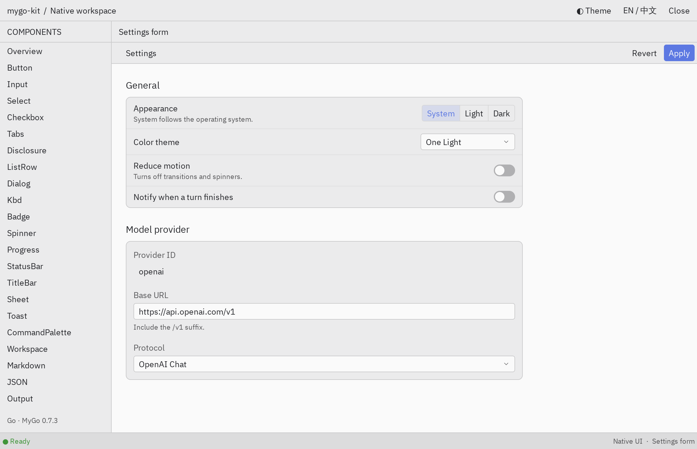

# mygo-kit

English | [简体中文](README.zh-CN.md)

A native Go component library built on [MyGo](https://github.com/egoist/mygo), styled after Zed: continuous panels, compact toolbars, controls with small corner radii, and One Light / One Dark color schemes. Components return MyGo’s `ui.Element` directly. They do not create a separate application runtime or access the network. Only the terminal starts background goroutines.

<picture>
  <source media="(prefers-color-scheme: dark)" srcset="website/public/screenshots/settings-dark.png">
  
</picture>

**[Documentation](https://vaalacat.github.io/mygo-kit/)** · **[Live gallery](https://vaalacat.github.io/mygo-kit/preview/?page=Overview&full)** (WebAssembly version running in the browser)

## Components

- Controls: buttons, inputs, Select, switches, segmented controls, tabs, menus, completion overlays, dialogs, Toast, and a command palette.
- Forms: fields, settings pages, settings sections, and settings rows.
- Reading: streaming Markdown, JSON trees, ANSI output, diffs, patch snippets, images, and a vt-based terminal.
- Layout: a workspace with left, right, and bottom docks, title bars, status bars, split panes, virtual lists, and trees.

## Installation

```sh
go get github.com/VaalaCat/mygo-kit
```

Requires Go 1.27.3 and MyGo v0.7.3. Linux requires GTK3. macOS uses system frameworks.

## Quick start

```go
package main

import (
	"log"
	"strconv"

	kit "github.com/VaalaCat/mygo-kit"
	"github.com/egoist/mygo"
	"github.com/egoist/mygo/ui"
)

var count int

func main() {
	if err := kit.RegisterFonts(); err != nil {
		log.Fatal(err)
	}
	mygo.App.WhenReady(func() {
		mygo.NewWindow(mygo.WindowOptions{Title: "Hello", Width: 480, Height: 320, Content: ui.View(view)})
	})
	if err := mygo.App.Run(); err != nil {
		log.Fatal(err)
	}
}

func view(c *ui.Context) {
	theme := kit.OneLight()
	kit.ApplyTheme(c, theme)
	ui.Column(c).Fill().Children(func() {
		kit.Header(c, "Hello", nil)
		ui.Column(c).Padding(theme.Space(4)).Gap(theme.Space(2)).Children(func() {
			ui.Text(c, "Clicks: "+strconv.Itoa(count))
			if kit.PrimaryButton(c, "Click me").Clicked() {
				count++
			}
		})
	})
}
```

Your application owns the theme and calls `ApplyTheme` once per frame. See the [documentation](https://vaalacat.github.io/mygo-kit/) for theme customization, dark mode, and component usage.

## Run locally

```sh
go run ./cmd/gallery                 # Component gallery
cd website && bun install && bun run dev   # Docs site with live previews
```

## License

[MIT](LICENSE). See [THIRD_PARTY_NOTICES.md](THIRD_PARTY_NOTICES.md) for third-party sources and licenses.
