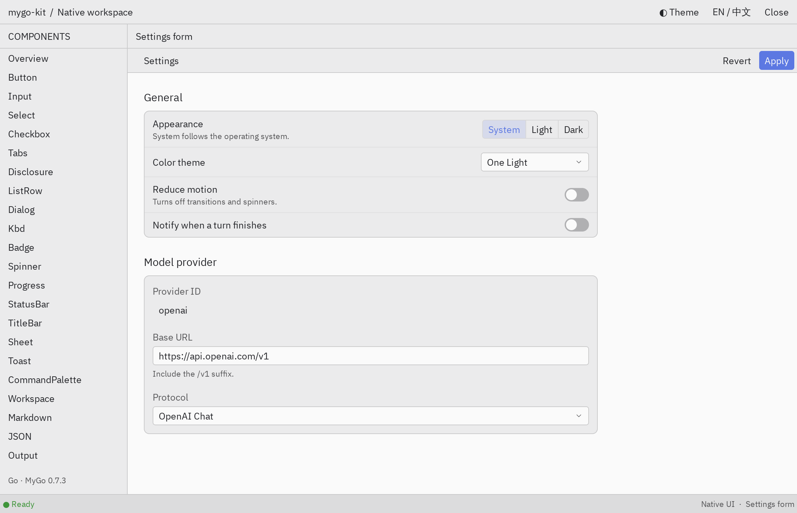

# mygo-kit

[English](README.md) | 简体中文

基于 [MyGo](https://github.com/egoist/mygo) 的原生 Go 组件库，样式参照 Zed：连续面板、紧凑的工具栏、小圆角控件，以及 One Light / One Dark 配色。组件直接返回 MyGo 的 `ui.Element`，不另起应用运行时，也不联网；除终端外不启动后台 goroutine。

<picture>
  <source media="(prefers-color-scheme: dark)" srcset="website/public/screenshots/settings-dark.png">
  
</picture>

**[文档](https://vaalacat.github.io/mygo-kit/zh/)** · **[在线画廊](https://vaalacat.github.io/mygo-kit/preview/?page=Overview&full&lang=zh-Hans)**（浏览器里运行的 WebAssembly 版本）

## 包含什么

- 控件：按钮、输入框、Select、开关、分段控件、页签、菜单、补全浮层、对话框、Toast、命令面板。
- 表单：字段、设置页、设置分组和设置行。
- 阅读：流式 Markdown、JSON 树、ANSI 输出、diff、补丁片段、图片，以及基于 vt 的终端。
- 布局：带左右下三个 Dock 的工作区、标题栏、状态栏、分栏、虚拟列表和树。

## 安装

```sh
go get github.com/VaalaCat/mygo-kit
```

需要 Go 1.27.3 和 MyGo v0.7.3。Linux 需要 GTK3，macOS 使用系统框架。

## 快速开始

```go
package main

import (
	"log"
	"strconv"

	kit "github.com/VaalaCat/mygo-kit"
	"github.com/egoist/mygo"
	"github.com/egoist/mygo/ui"
)

var count int

func main() {
	if err := kit.RegisterFonts(); err != nil {
		log.Fatal(err)
	}
	mygo.App.WhenReady(func() {
		mygo.NewWindow(mygo.WindowOptions{Title: "Hello", Width: 480, Height: 320, Content: ui.View(view)})
	})
	if err := mygo.App.Run(); err != nil {
		log.Fatal(err)
	}
}

func view(c *ui.Context) {
	theme := kit.OneLight()
	kit.ApplyTheme(c, theme)
	ui.Column(c).Fill().Children(func() {
		kit.Header(c, "Hello", nil)
		ui.Column(c).Padding(theme.Space(4)).Gap(theme.Space(2)).Children(func() {
			ui.Text(c, "点击次数："+strconv.Itoa(count))
			if kit.PrimaryButton(c, "点我").Clicked() {
				count++
			}
		})
	})
}
```

主题由应用持有，每帧调用一次 `ApplyTheme`。主题定制、暗色模式和每个组件的用法见[文档](https://vaalacat.github.io/mygo-kit/zh/)。

## 本地运行

```sh
go run ./cmd/gallery                 # 组件画廊
cd website && bun install && bun run dev   # 文档站，含在线预览
```

## 许可

[MIT](LICENSE)。第三方来源与许可见 [THIRD_PARTY_NOTICES.zh-CN.md](THIRD_PARTY_NOTICES.zh-CN.md)。
